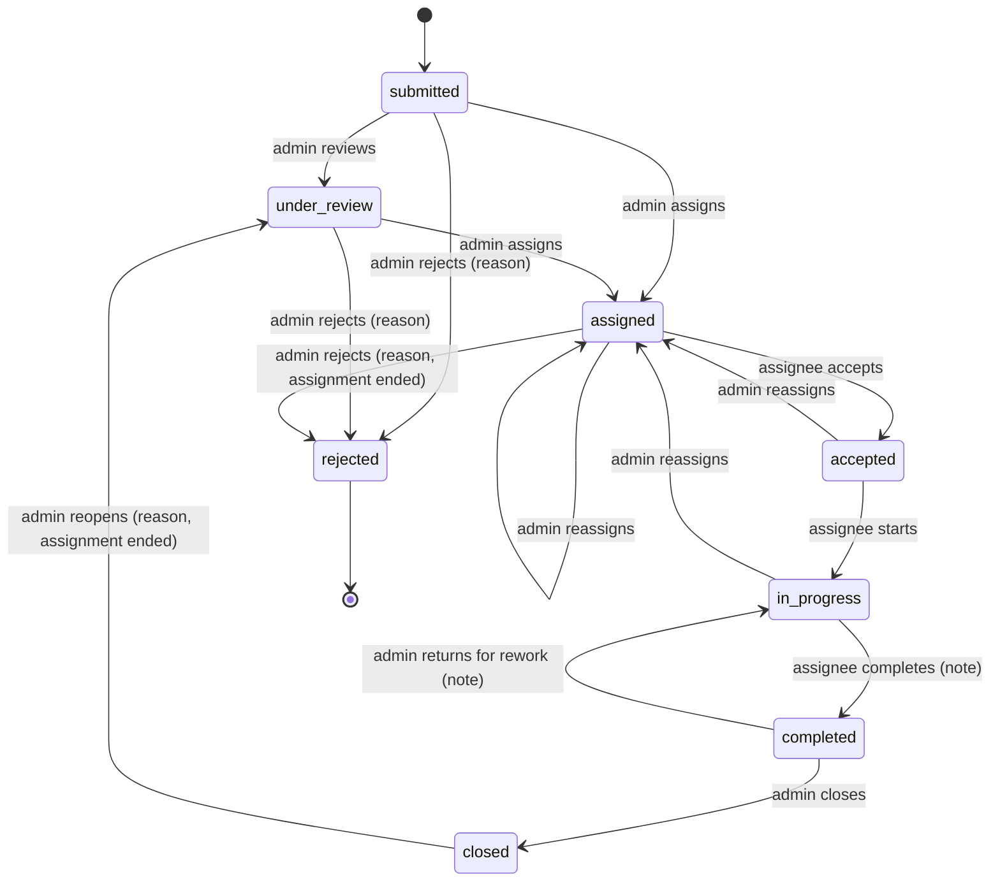
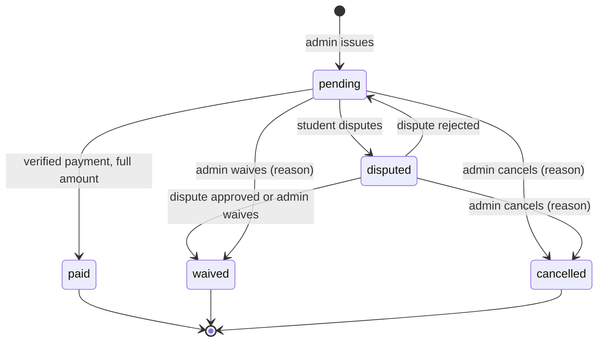
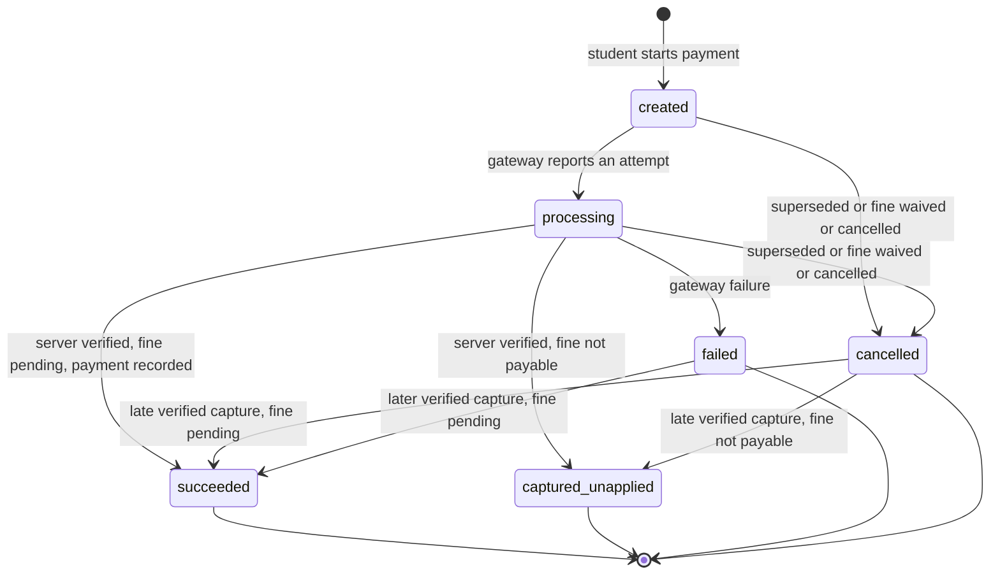
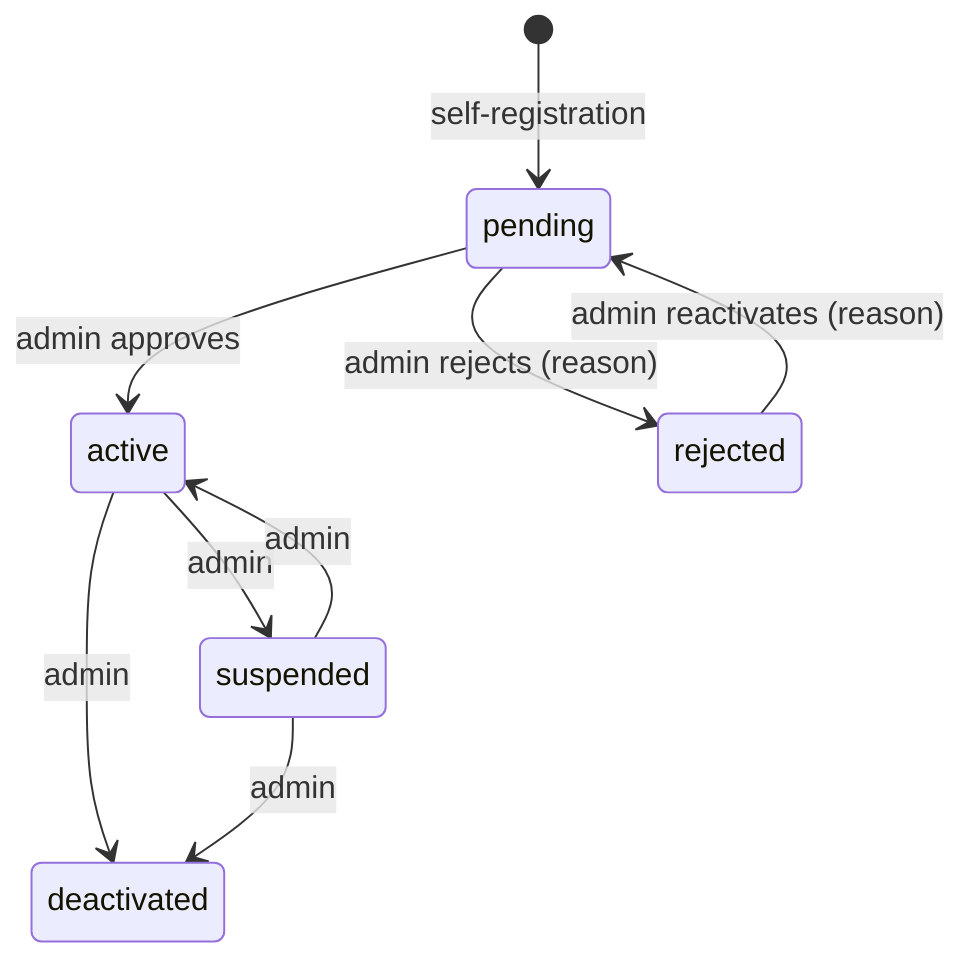

# HostelCare Entity-Relationship Diagram

**Revision 2** (see the revision history in [database-design.md](database-design.md)). Changes from Revision 1: new `payment_attempts`; `payments` is now verified-only; `password_reset_tokens` lost `purpose`; `users` lost `must_change_password`; complaints gained `location_type`, `block_id`, `location_detail` and nullable `room_id`; complaint flow gained `closed -> under_review` (reopen); refund states removed.

Attributes shown are keys and behaviour-driving columns; the design document lists every column, constraint and index.

Legend: `PK` primary key, `FK` foreign key, `UK` unique. All foreign keys are `ON DELETE RESTRICT`. Profile tables are keyed by `user_id`.

## Full model (20 tables)

```mermaid
erDiagram
    users ||--o| student_profiles : "is a (role student)"
    users ||--o| staff_profiles : "is a (role staff)"
    users ||--o{ password_reset_tokens : "may have"
    users ||--o{ notifications : "receives"
    users ||--o{ audit_logs : "acts in"
    users ||--o{ users : "created_by"

    blocks ||--o{ rooms : "contains"
    rooms ||--o{ room_allocations : "houses"
    student_profiles ||--o{ room_allocations : "is allocated"
    rooms ||--o{ student_profiles : "requested by"

    student_profiles ||--o{ complaints : "submits"
    rooms ||--o{ complaints : "room complaints"
    blocks ||--o{ complaints : "common-area complaints"
    complaints ||--o{ complaint_assignments : "assigned via"
    staff_profiles ||--o{ complaint_assignments : "works"
    complaints ||--o{ complaint_updates : "has"
    complaint_assignments ||--o{ complaint_updates : "made under"
    complaints ||--o{ complaint_internal_notes : "admin notes"
    complaints ||--o{ complaint_history : "ledger"

    student_profiles ||--o{ fines : "receives"
    fines ||--o| fine_disputes : "disputed by"
    fines ||--o{ fine_history : "ledger"
    fines ||--o{ payment_attempts : "paid via attempts"
    fines ||--o| payments : "settled by (full payment)"
    payment_attempts ||--o| payments : "succeeds as"
    payment_attempts ||--o{ payment_events : "events"
    payments ||--o{ fine_history : "referenced by"
    payment_attempts ||--o{ fine_history : "referenced by"
    fine_disputes ||--o{ fine_history : "referenced by"

    users {
        bigint id PK
        uuid public_id UK
        varchar email UK
        varchar full_name
        varchar password_hash "argon2id or ! marker"
        varchar role "student staff admin"
        varchar status "pending active rejected suspended deactivated"
        int session_version
        bigint created_by FK
    }
    student_profiles {
        bigint user_id PK
        varchar roll_number UK
        bigint requested_room_id FK
        bigint reviewed_by FK
        timestamptz reviewed_at
    }
    staff_profiles {
        bigint user_id PK
        varchar staff_code UK
        varchar trade
        varchar shift
    }
    password_reset_tokens {
        bigint id PK
        bigint user_id FK
        char token_hash UK "sha256 only"
        bigint requested_by FK "admin trigger or null"
        timestamptz expires_at "max 30 minutes"
        timestamptz used_at
        timestamptz revoked_at
    }
    blocks {
        bigint id PK
        varchar code UK
        varchar name UK
        boolean is_active
    }
    rooms {
        bigint id PK
        bigint block_id FK
        varchar room_number "UK with block_id"
        smallint capacity
        boolean is_active
    }
    room_allocations {
        bigint id PK
        bigint room_id FK
        bigint student_user_id FK
        smallint bed_number
        date start_date
        date end_date "exclusive, null = open"
        bigint allocated_by FK
        bigint ended_by FK "null iff end_date is null"
        text end_reason "null iff end_date is null"
    }
    complaints {
        bigint id PK
        varchar reference_no UK
        bigint student_user_id FK
        varchar location_type "room common_area"
        bigint room_id FK "room only"
        bigint block_id FK "common area optional"
        varchar location_detail "common area"
        varchar title
        text description
        varchar category "optional"
        varchar priority "low medium high"
        varchar status
        text rejection_reason
        int version
    }
    complaint_assignments {
        bigint id PK
        bigint complaint_id FK "partial UK where ended_at is null"
        bigint staff_user_id FK
        bigint assigned_by FK
        text instructions "not student visible"
        timestamptz accepted_at
        timestamptz ended_at "null = active"
    }
    complaint_updates {
        bigint id PK
        bigint complaint_id FK
        bigint assignment_id FK
        bigint author_user_id FK
        varchar update_type "progress completion"
        text body
    }
    complaint_internal_notes {
        bigint id PK
        bigint complaint_id FK
        bigint author_user_id FK
        text body "admin only"
    }
    complaint_history {
        bigint id PK
        bigint complaint_id FK
        bigint actor_user_id FK
        varchar action "includes reopened"
        varchar from_status
        varchar to_status
        text note "reason mandatory for rework reject reopen"
        bigint assignment_id FK
        bigint update_id FK
    }
    fines {
        bigint id PK
        varchar reference_no UK
        bigint student_user_id FK
        numeric amount_inr "numeric 12 2"
        date issue_date
        date due_date
        bigint issued_by FK
        varchar status "pending disputed paid waived cancelled"
        text resolution_reason
    }
    fine_disputes {
        bigint id PK
        bigint fine_id FK "UK one per fine"
        bigint raised_by FK
        text reason
        varchar status "open approved rejected"
        bigint decided_by FK
        text decision_reason
    }
    fine_history {
        bigint id PK
        bigint fine_id FK
        bigint actor_user_id FK
        varchar action
        bigint payment_id FK
        bigint payment_attempt_id FK
        bigint dispute_id FK
    }
    payment_attempts {
        bigint id PK
        uuid public_id UK
        bigint fine_id FK "partial UK while open"
        bigint initiated_by FK
        numeric amount_inr
        varchar gateway_order_id UK
        varchar gateway_payment_id UK
        varchar status "created processing succeeded captured_unapplied failed cancelled"
        timestamptz verified_at
    }
    payments {
        bigint id PK
        uuid public_id UK
        bigint fine_id FK "UK full payments only"
        bigint payment_attempt_id FK "composite FK with fine_id, UK null for manual"
        varchar channel "razorpay manual"
        numeric amount_inr
        varchar verification_method "webhook api_fetch manual_entry"
        timestamptz verified_at
        varchar receipt_number UK
        bigint recorded_by FK "admin for manual"
    }
    payment_events {
        bigint id PK
        bigint payment_attempt_id FK
        varchar source
        varchar gateway_event_id UK "idempotency key"
        boolean signature_valid
        varchar outcome
        jsonb payload "sanitised"
    }
    notifications {
        bigint id PK
        uuid public_id UK
        bigint recipient_user_id FK
        varchar category
        varchar event_type
        text message
        timestamptz read_at
    }
    audit_logs {
        bigint id PK
        timestamptz occurred_at
        bigint actor_user_id FK
        varchar action
        varchar target_type
        varchar target_id
        jsonb metadata
        inet ip_address
    }
```

Every `*_by`, `author_user_id`, `actor_user_id`, `initiated_by` and `recorded_by` column is also a foreign key to `users(id)`; those edges are omitted for readability. Student-owned columns (`complaints.student_user_id`, `fines.student_user_id`, `room_allocations.student_user_id`, `fine_disputes.raised_by`) reference `student_profiles(user_id)`; `complaint_assignments.staff_user_id` references `staff_profiles(user_id)`.

## Complaint status flow

## Fine status flow

## Payment attempt flow

A fine becomes `paid` only when an attempt reaches `succeeded` (a `payments` row exists). A verified capture that cannot be applied is `captured_unapplied` and waits for administrator attention; there is no automatic refund state.

## Student account flow

